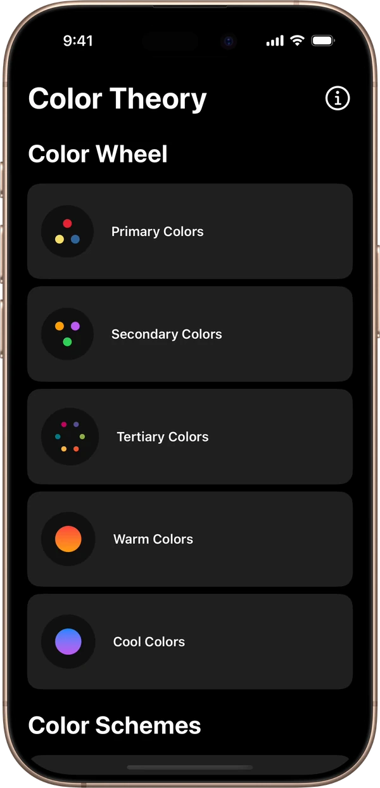

# Color Theory
An interactive iOS game that teaches the fundamentals of color theory. Each level is a short puzzle: put shuffled colors back in order, then read a quick recap of the idea behind them.

<div align="center">
  
</div>

### How to play
Tap an unlocked color, then tap another to swap them. Blocks with a lock stay where they are and act as hints. The level is complete when the colors are arranged to match its objective.

### Levels
**Color Wheel**
- **Primary:** red, yellow and blue.
- **Secondary:** the colors you get by mixing two primaries.
- **Tertiary:** the mix of a primary and a neighboring secondary.
- **Warm:** colors of energy, brightness and action.
- **Cool:** colors of calm and serenity.

**Color Schemes**
- **Complementary:** opposites on the color wheel.
- **Analogous:** neighbors on the color wheel.
- **Triadic:** three colors spaced evenly around the wheel.

### It's all in the details:
- Every level pairs its puzzle with a short explanation, plus a How to Play overlay and a recap when you finish.
- Next Level takes you straight into the following lesson, and your progress is saved between launches.
- Swaps are animated. Picking a color, swapping it and finishing a level each play their own sound.
- The color wheel diagrams are drawn in SwiftUI from the game's own palette.
- Boards size themselves to the screen, so the game works on iPhone and on iPad in any orientation.
- VoiceOver reads each block's color name, hue, brightness and position.
- Finishing all eight levels unlocks a final screen where you can start over.

### Tools and Frameworks used:
- SwiftUI
- SpriteKit, shown inside SwiftUI with `SpriteView`. One shared scene runs every level.
- [GlassMorphismic](https://github.com/taichi-dm/GlassMorphismic) for the blurred overlays, pinned to a fixed commit

### Requirements
- iOS 15 or later
- Xcode 15 or later. Swift Package Manager fetches GlassMorphismic.

### Tests
The puzzle rules, every level's layout and saved progress are covered by unit tests. Run them with ⌘U in Xcode, or:
```sh
xcodebuild test -project ColorTheory.xcodeproj -scheme ColorTheory -destination 'platform=iOS Simulator,name=iPhone 16 Pro'
```

### Credits
- Warm colors photo by [Birger Strahl](https://unsplash.com/photos/t6fQwCYrIcw) and cool colors photo by [David Becker](https://unsplash.com/photos/dMeEJRE18VI), both on Unsplash.
- The About screen photo is also from Unsplash.

### License
[MIT](LICENSE)
